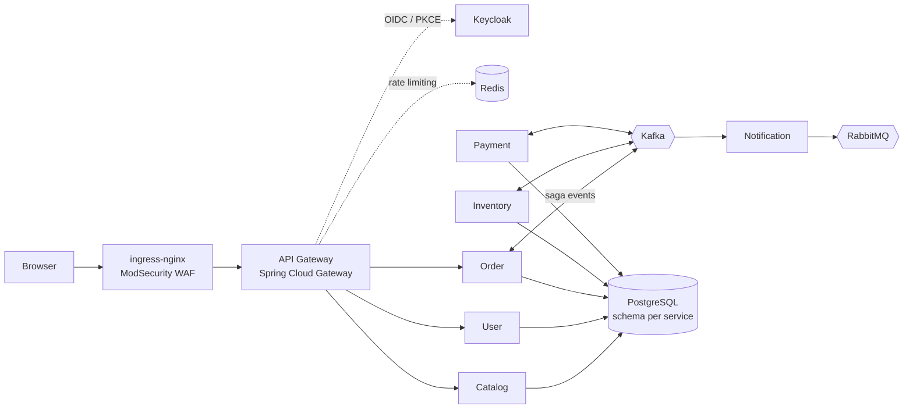

# Ravi Kiran Kurakula

### Software Architect · Solution Architect · TOGAF® 9 Certified

I design distributed, secure and observable systems, and I document the reasoning behind them. I have **19+ years** in enterprise software across banking, financial services, supply chain and eCommerce, including **4+ years as a solution architect**. Previous employers include Bank of America, Moody's, eBay, Nokia, Oracle, Embecta and TCS.

📍 Hyderabad, India · Open to Software / Solution Architect and Senior Software Engineer roles

---

## How I architect

- **Decisions are written down, with their trade-offs.** Every significant choice gets an Architecture Decision Record covering context, options considered, evidence, the decision and its consequences.
- **I start from the framework.** Architecture work follows TOGAF ADM phases, from vision and business architecture through data, application, technology and governance.
- **Security comes in independent layers.** Workload identity, network policy, token-based authorization and an edge WAF each hold on their own, so no single control is load-bearing.
- **I build in observability from the start.** Traces, metrics, logs and a correlation ID follow every request, including across asynchronous hops.
- **I state the system's limits openly.** CAP/PACELC positioning, capacity estimates, single-replica choices and known gaps are documented, not hidden.

---

## Featured architecture work

### 🛒 [eCommerce Platform](https://github.com/ravik775/eCommerce): event-driven microservices on zero-trust Kubernetes

| Concern | Architecture decision |
|---|---|
| **Consistency** | Choreography saga + transactional outbox + idempotent consumers. The system is positioned explicitly as **PA/EL** under CAP/PACELC |
| **Service identity** | **SPIFFE/SPIRE X.509-SVIDs with app-level mTLS, and no service mesh.** The ADR keeps two researched reversals instead of hiding them |
| **Access control** | Keycloak (Google federated) with OIDC + PKCE. JWT role checks are enforced **independently in every service**, not just at the gateway |
| **Platform security** | Default-deny NetworkPolicies, Pod Security Standard `restricted`, read-only root filesystems, Sealed Secrets, and a ModSecurity + OWASP CRS WAF at the edge |
| **Observability** | OpenTelemetry → Tempo, Prometheus + Alertmanager, Loki, Grafana. Error spans are always sampled, and one correlation ID carries through Kafka hops |
| **DevSecOps** | CI gates: gitleaks, CodeQL, OWASP Dependency-Check, Trivy image scanning, and an OWASP ZAP scan |
| **Governance** | **66 ADRs** and a **TOGAF ADM** document set from the Preliminary phase through Phase H, plus SOC 2 control mapping, data classification and capacity planning |

Built with Java 21, Spring Boot 3.5, 10 Maven modules, Kafka, RabbitMQ, PostgreSQL, Redis, Keycloak, SPIRE and Kubernetes.

### 🤖 [AI Architecture Lab](https://github.com/ravik775/ai-architecture-lab): reference architectures for GenAI and agentic systems

Each project isolates one architectural concern of an AI system:

| Project | Architectural focus |
|---|---|
| **pydanticai** | Hexagonal architecture around a PydanticAI agent. Typed tools, enforced structured output and a fallback model; the agent loop is tested deterministically with **no live LLM calls** |
| **expense-ai** | **LangGraph** human-in-the-loop workflow with durable PostgreSQL checkpointing (`interrupt` / `resume`). Uses a composable resilience pipeline (retry, circuit breaker, cache) and RAG policy retrieval |
| **genai-observability** | Two separate OpenTelemetry pipelines (traces vs metrics), head and tail sampling, a vendor-neutral exporter and layered PII redaction aligned with the OWASP LLM Top 10 |
| **[loan-processing-architecture](https://github.com/ravik775/ai-architecture-lab/tree/main/loan-processing-architecture)** | Spring Boot microservices with **SPIRE workload attestation**: spiffe-helper sidecars issue short-lived SVIDs for gateway-to-service **mTLS**. Includes Eureka, Redis rate limiting, RabbitMQ, Keycloak, Kubernetes manifests and TOGAF documents |
| **MCP & provider abstraction** | An MCP server (Resources / Prompts / Tools), plus LLM provider abstraction via LiteLLM and a Factory pattern |

Built with Python, FastAPI, LangGraph, PydanticAI, LangChain, LiteLLM, ChromaDB, OpenTelemetry, Docker and Kubernetes.

---

## Architecture competencies

| Area | Depth |
|---|---|
| **Enterprise architecture** | TOGAF ADM, ADRs, NFRs, capacity planning, CAP/PACELC trade-offs, compliance mapping (SOC 2) |
| **Distributed systems** | Microservices, event-driven sagas, transactional outbox, idempotency, API gateways, service discovery |
| **Security architecture** | Zero trust, OAuth2 / OIDC / PKCE, mTLS, SPIFFE/SPIRE, WAF, secrets management, SAST / SCA / DAST |
| **Cloud & platform** | AWS, Kubernetes, Docker, Pod Security Standards, NetworkPolicies |
| **Observability** | OpenTelemetry, Prometheus, Grafana, Tempo, Loki, sampling strategy |
| **GenAI & agentic AI** | LangGraph, PydanticAI, RAG, MCP, LLM provider abstraction, LLM security |

## 📜 Certification

**TOGAF® 9 Certified**: The Open Group Architecture Framework
